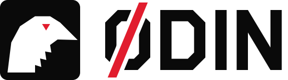

# Odin by Protect24x7 — brand guide

**Every project. On watch.**

Decided with the user on 27 Sep 2026, taking the lead from protect24x7.com.
Odin is a Protect24x7 sub-brand: its own name and mark, visibly part of the
parent family. Staff, partners and customers all see it.

## The idea

In Norse myth, Odin's two ravens flew out every morning and came back to tell
him what they had seen. Odin does the same for project delivery. It watches
every rollout, stage and deadline and reports back, so nothing stalls unseen.
The parent's promise is "Your shield never sleeps". Odin's is the delivery
version of that promise.

## Logo

| File | Use |
|---|---|
| `brand/odin-logo-ink.svg` | Mark + wordmark on light backgrounds |
| `brand/odin-logo-white.svg` | Mark + wordmark on black |
| `brand/odin-wordmark-ink.svg` / `-white.svg` | Wordmark alone |
| `brand/odin-mark.svg` | The raven tile alone: favicon, avatars, small spaces |
| `brand/odin-social.png` | Link preview, 1200×630 |

- **The mark** is a geometric raven head in white on a black tile, with a red eye. The throat has stepped hackles, which is what makes it read as a raven and not a generic bird.
- **The wordmark** is ODIN in chamfered letters that match Chakra Petch, drawn as shapes so it never depends on a font. The O is struck through in red. That gives Ø, a Norse letter, and echoes the red slash in the parent's "24/7".
- **The byline** reads "by Protect24x7" with "24x7" in red. Use it wherever someone outside the company sees Odin: sign-in, emails and printed reports.
- Keep clear space of at least half the tile's width around the logo. Don't recolour, stretch, outline or add effects. The only red is the slash and the eye.
- In code, use `RavenMark`, `Wordmark`, `Logo`, `Byline` and `Eyebrow` from `frontend/src/components/Brand.tsx`. Don't copy the paths.

## Colour

| Token | Hex | Role |
|---|---|---|
| `--brand-ink` | `#0A0A0A` | Brand panels, mark tile, email band |
| `--brand-red` | `#E11D2E` | Logo slash, raven eye, tagline second line, eyebrow numbers, live dot |
| `--brand-paper` | `#FFFFFF` | Text and raven on brand ink |
| `--brand-muted` | `#B8B8B4` | Secondary text on brand ink |

**Red is brand, not UI.** Inside the app, red means a project is overdue. Brand
red therefore stays on brand surfaces and never marks a button, link or
selection. The app accent remains each user's choice, blue by default.

## Type

- **Chakra Petch** 600/700 is the brand face, the same as the parent's. Use it for page titles, the tagline, the byline, eyebrows and panel numbers.
- **Inter** is used for everything a person reads or types in the app.
- On brand surfaces, labels are uppercase and tracked at 0.16em. In the app, labels are sentence case.

## Signature details

- **Numbered eyebrows** such as "01 / Project lifecycle". On brand surfaces the number is red. In the app, panel titles are numbered in muted ink.
- **The watch clock** shows local time with a pulsing red dot, as in "19:02 GMT+4 · On watch", on the sign-in panel.
- **Diagonal texture** is a faint 135° rule on brand ink, never on the app's own ground.

## Voice

The voice is plain, direct and watchful. Wording is calm and confident, never alarming.

- **Tagline:** Every project. On watch.
- **Supporting line:** Every rollout, stage and deadline, from kickoff to handover. Nothing stalls unseen.
- **In the app**, brand voice is a light touch. Actions, errors and labels stay plain ("Advance to Deployment", "That did not save"). Voice may appear in empty states, sign-in and emails.
- Write "Odin" in running text and ODIN only in the logo. Never write "O.D.I.N.".

## Where the brand appears

| Surface | Treatment |
|---|---|
| App header | Raven mark + wordmark |
| Sign-in, password reset, email-link pages | Black brand panel beside the form, or above it on phones |
| Page titles | Chakra Petch |
| Project, settings, account, project form | Numbered panel titles |
| Printed reports / PDF | Logo, byline and tagline across the top of page one |
| Emails | Black band with wordmark and byline, tagline footer |
| Error page, loading splash | Raven mark |
| Favicon, home-screen icon, link preview | Raven tile, `og.png` |

The legacy guest pages and the login fallback form keep their old look until they
retire. Their stylesheet is frozen.
